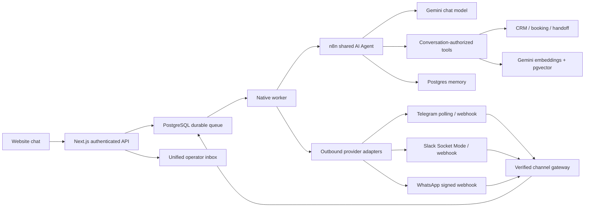

# AgentFlow AI

### Connected. Intelligent. Human.

A native-Windows operations workspace that connects customer conversations to an n8n AI agent, a persistent CRM, conflict-safe appointments, a vector knowledge base and human operators.

**Website · Telegram · Slack · WhatsApp Business Cloud**

[](https://github.com/3mk-ml/AI-Agent/actions/workflows/ci.yml)

> This repository contains the application source, workflow exports, migrations and tests. It is not a hosted service. Provider credentials, an initialized database and published n8n workflows are required for live operation. Read [verification status](docs/TEST_RESULTS.md) before treating an integration as verified. Nexa Digital Solutions is fictional demonstration data, never a claim about a real business.

## What is included

- A responsive dark-navy and mint operations console: overview, unified inbox, AI assistant, CRM, appointments, knowledge, automations, execution monitoring and connection settings.
- One shared n8n AI Agent with Gemini, Postgres conversation memory and six conversation-authorized business tools.
- Official WhatsApp Cloud API messaging, Telegram polling/webhooks, and Slack Socket Mode/HTTP events. Incoming text, supported attachments, outgoing replies and human takeovers use real provider APIs.
- Supabase/PostgreSQL records, 768-dimensional pgvector retrieval, transactional scheduling, duplicate-event prevention and a durable work queue.
- Transparent lead-completeness scoring plus separate AI advisory enrichment; message classification and reply drafts; PDF/image/text extraction; consent-aware follow-up drafts.
- Operator-reviewed Airtable and Google Sheets exports. Optional Slack/SMTP failure and handoff notifications.
- Signed sessions, authenticated webhooks, encrypted local settings, bounded uploads, retry backoff and explicit handling of uncertain delivery.

No simulated AI replies, fabricated analytics or pretend delivery receipts. An unavailable integration produces a visible error.

> **Credential setup:** Follow [secure credentials and live testing](docs/CREDENTIALS_SETUP.md). Generate local shared secrets with `npm run secrets:generate`; never commit provider keys or connection strings. Rotate any keys already shared outside the private service configuration.

## Run on Windows — no Docker

Use Node.js 24 LTS and PowerShell. The application accepts Node 22.16–24; the separately installed n8n version may have stricter requirements. No Docker, WSL or local database server is required when using Supabase.

Clone or download this repository, open its folder, then run:

```powershell
git clone https://github.com/3mk-ml/AI-Agent.git
cd AI-Agent
npm install --prefer-offline --no-audit --no-fund
npm run setup
npm run dev
```

The setup command prints a **one-time local setup token**. Open `http://127.0.0.1:3000/login`, enter that token and create an administrator password. Do not share the token, password or `.runtime` directory.

In **Connections**:

1. Save your Supabase PostgreSQL **session-pooler** connection string. Use the database password, not an API key. Download/configure the project's CA certificate when its TLS chain requires it; do not disable certificate verification.
2. Click **Apply database migrations**. The application creates its `agentflow` schema and required extensions. Use a new development database/project or take a backup first.
3. Save a Gemini API key and a chat model ID actually available to your account. Select a compatible embedding model; the database expects 768-dimensional embeddings. Run diagnostics.
4. Configure n8n using [the native setup guide](docs/N8N_SETUP.md). Import the workflows, bind real credentials and publish the customer-agent workflow.
5. In another terminal in the same repository, run `npm run worker`.
6. Add and index the fictional handbook in **Knowledge**, then start a customer conversation at `http://127.0.0.1:3000/chat`.

You can open the interface before configuring external services. Database-backed pages intentionally show an error or setup prompt until the database is ready.

### Separate processes

| Terminal | Command | Purpose |
|---|---|---|
| Application | `npm run dev` | Dashboard and backend, loopback port 3000 |
| Background worker | `npm run worker` | Agent requests, indexing, drafts and outbound delivery |
| n8n | `powershell -File scripts/n8n.ps1 -Action start` | Local workflow engine, loopback port 5678 |
| Telegram, optional | `npm run telegram` | Private bot chats through long polling |
| Slack, optional | `npm run slack` | Workspace events through Socket Mode |
| Webhook ingress, optional | `npm run ingress` | Only provider webhook routes, loopback port 3001 |

The startup scripts do **not** reinstall n8n automatically. Never start a second installer while your existing npm installation is running. Do not clear npm's cache just because it prints dependency warnings.

## Connect the channels

Start with [Telegram](docs/TELEGRAM_SETUP.md), then [Slack](docs/SLACK_SETUP.md). Both can receive messages locally without publishing a webhook URL. [WhatsApp](docs/WHATSAPP_SETUP.md) requires an HTTPS callback reachable by Meta. Tunnel the dedicated ingress on port **3001**, not the dashboard or n8n editor.

Tokens belong in the local Connections form or server-side environment variables, never in GitHub issues, commits, screenshots, `NEXT_PUBLIC_*` variables or shared chat. The public repository contains examples only.

## Architecture



Business actions are enforced server-side; the model does not get arbitrary database access. Provider identities are not automatically merged across channels. The database rejects overlapping confirmed appointments even when simultaneous requests pass an earlier availability check.

## n8n deliverables

The [`workflows/`](workflows/) directory contains inactive, credential-free definitions for the shared customer agent, lead intake, scheduled follow-up drafts, email/document intake, a reusable business-tool sub-workflow and error monitoring. `npm run workflows` checks graph structure and prepares local copies. `npm run workflows:import` can create drafts through your authenticated n8n API without overwriting existing workflows or activating them.

Importing a JSON file is not proof of successful execution. Follow the live acceptance checklist after assigning credentials.

## Quality checks

```powershell
npm test
npm run typecheck
npm run build
npm start
```

Optional browser tests:

```powershell
npx playwright install chromium
npm run test:e2e
```

Browser tests create an administrator in a disposable runtime directory. Run them in a clean test checkout, not against your configured production or personal workspace. GitHub Actions performs these checks in fresh Windows/Linux runners and uploads available reports/screenshots. Consult the latest Actions run, not an old badge or README claim.

## Handover documentation

- [Architecture and data flow](docs/ARCHITECTURE.md)
- [Native n8n setup and credential mapping](docs/N8N_SETUP.md)
- [Telegram](docs/TELEGRAM_SETUP.md), [Slack](docs/SLACK_SETUP.md), [WhatsApp](docs/WHATSAPP_SETUP.md)
- [Security and webhook boundaries](docs/WEBHOOK_SECURITY.md)
- [Editable prompt library](docs/PROMPT_LIBRARY.md)
- [Verification and live acceptance tests](docs/TEST_RESULTS.md)
- [Troubleshooting](docs/TROUBLESHOOTING.md)
- [Demo and handover walkthrough](docs/DEMO_SCRIPT.md)
- [Requirements coverage and limitations](docs/BUILD_REPORT.md)

## Honest scope boundaries

This is a single-workspace, single-operator MVP, not an audited multi-tenant production service. External Google Calendar/HubSpot synchronization, a live Gmail/IMAP inbox connector, PSTN voice calling, automatic cross-channel identity linking and team RBAC are not implemented. Email/form/ad events can enter through authenticated intake workflows; messages can also be submitted through the operator UI. Outbound marketing and follow-ups remain drafts unless an operator explicitly sends a permitted channel reply.

A recorded 15–20 minute walkthrough and a 14-day support agreement are human delivery commitments; this repository provides a walkthrough script, not a recorded video or an invented support contract. Keep the dashboard on loopback until deployment security, backups, retention, load handling and provider policies have been reviewed.
